# CodePilot AI — System Architecture

> **Architectural Specification and Component Design for Local AI-Driven Code Modification**

CodePilot AI is structured as a modular, layered CLI application designed to analyze unfamiliar Git repositories via command-driven terminal workflows (with optional in-code instruction comment hints), identify static code health concerns, construct bounded model contexts, generate candidate unified Git diffs without modifying files on disk, apply validated patches under explicit developer approval, safely execute tests with concurrency locking and configurable timeouts, recover non-destructively via pre-apply backup snapshots, and provide standalone local GGUF model execution without mandatory cloud services or external daemons.

---

## 1. High-Level System Architecture

```mermaid
flowchart TD
    subgraph UserInterface["User & CLI Layer"]
        CLI["Typer CLI (cli.py)"]
        Config["Configuration Loader (config.py)"]
        Logger["Secret-Masking Logger (logging_config.py)"]
        App["App Coordinator (app.py)"]
    end

    subgraph StaticAnalysis["Repository Discovery & Static Analysis"]
        Discovery["Discovery Engine (discovery.py)"]
        Extractors["AST & Generic Extractors (extractors/)"]
        EntryPoints["Entry Point Detector (entry_points.py)"]
        Relations["Relationship Mapper (relationships.py)"]
    end

    subgraph CommentParsing["AI Instruction Comment Engine"]
        Parser["Comment Parser (comment_parser.py)"]
        Adapters["Multi-Language Adapters (adapters.py)"]
        Resolver["AST Symbol Resolver (symbol_resolver.py)"]
    end

    subgraph ContextEngine["Context & Prompt Assembly"]
        Context["Project Context Engine (context/engine.py)"]
        PromptBuilder["Prompt Builder v1.0.0 (prompt.py)"]
    end

    subgraph ModelRuntime["Modular Model Runtime"]
        Factory["Model Client Factory (models/factory.py)"]
        Ollama["Ollama Client (ollama_client.py)"]
        Standalone["Standalone GGUF Client (standalone_client.py)"]
        Mock["Mock Client (mock_client.py)"]
    end

    subgraph SafeModification["Patching & Reversible Recovery"]
        Planner["Task Planner (planner.py)"]
        Fixer["Diff Generator (fixer.py)"]
        PendingPatch[("Staged Patch\npending_patch.json")]
        Patcher["Approved Patcher (patcher.py)"]
        Recovery["Backup & Rollback (recovery.py)"]
        Backups[("Pre-Apply Backups\nmanifest.json")]
    end

    subgraph TestExecution["Safe Test Execution"]
        Tester["Safe Test Runner (tester.py)"]
        LockFile[("Concurrency Lock\ntest.lock")]
        TestAnalyzer["Failure Analyzer (test_analyzer.py)"]
    end

    subgraph SecurityEnclave["Security & File Ownership Policy"]
        RootDetect["Project Root Detector (security.py)"]
        Ownership["Ownership Classifier (security.py)"]
        Perms["Permission Checker (security.py)"]
        PathGuard["Path Traversal Guard (security.py)"]
    end

    CLI --> App
    App --> Config
    App --> RootDetect
    App --> SecurityEnclave

    CLI --> Discovery
    Discovery --> Extractors
    Extractors --> Relations
    Extractors --> EntryPoints

    CLI --> Parser
    Parser --> Adapters
    Adapters --> Resolver

    CLI --> Context
    Context --> Discovery
    Context --> Resolver
    Context --> PromptBuilder

    PromptBuilder --> Factory
    Factory --> Ollama
    Factory --> Standalone
    Factory --> Mock

    Factory --> Fixer
    Fixer --> PathGuard
    Fixer --> PendingPatch

    CLI --> Patcher
    Patcher --> Perms
    Patcher --> Recovery
    Recovery --> Backups
    Patcher --> PathGuard

    CLI --> Tester
    Tester --> LockFile
    Tester --> TestAnalyzer
    TestAnalyzer --> Fixer
```



---

## 2. Component Responsibilities & Subsystems

### 2.1 CLI Layer (`src/codepilot/cli.py` & `src/codepilot/core/app.py`)
- **CLI Framework:** Built using **Typer** and styled with **Rich** terminal components.
- **Dual Output Modality:** Every inspection and analysis command provides human-readable Rich formatting by default and machine-readable output when `--json` is supplied.
- **Predictable Exit Codes:** 
  - `0`: Success / clean execution.
  - `1`: System error, failed execution, or runtime exception.
  - `2`: Validation failure, security violation, or path traversal rejection.
- **Dynamic Diagnostics:** Coordinates system readiness checks (`codepilot doctor`) and real-time status inspection (`codepilot status`) without hardcoded state assumptions.

### 2.2 Configuration & Logging (`src/codepilot/config.py` & `src/codepilot/logging_config.py`)
- **Pydantic v2 Schema:** Strongly-typed configuration with strict validations, defaults, and type enforcement.
- **Cascading Precedence:** Hardcoded safe defaults $\rightarrow$ `.codepilot.toml` $\rightarrow$ Environment variables (`CODEPILOT_*`) $\rightarrow$ CLI options.
- **Secret Masking:** Formatter automatically redacts API keys, Bearer tokens, private keys, and passwords before records reach terminal or file outputs.

### 2.3 Repository Discovery & Static Analysis (`src/codepilot/core/analyzer/` & `src/codepilot/core/scanner.py`)
- **Discovery Engine (`discovery.py`):** Traverses repositories honoring `.gitignore`, ignoring build caches, virtual environments, and binary files.
- **Project Structure & Health Scanner (`scanner.py`):** In addition to optional comment scanning, discovers file extension distributions, configuration files, test directories, skipped files with exclusion reasons, and performs AST-based static defect detection (syntax errors, empty files) without requiring comments.
- **AST Symbol Extractors (`extractors/python.py`, `extractors/generic.py`):** Extracts modules, imports, classes, methods, functions, docstrings, and decorators using Python's standard `ast` module, falling back to regex patterns for non-Python sources.
- **Entry Point Detector (`entry_points.py`):** Scores and ranks executable scripts, CLI dispatchers, and WSGI/ASGI application instances.
- **Relationship Mapper (`relationships.py`):** Resolves intra-project import graphs and class inheritance hierarchies.
- **Context Builder (`context_builder.py`):** Formats token-budgeted prompt context for consumption by local models.

### 2.4 AI Instruction Comment Engine (`src/codepilot/core/parser/`)
- **Optional Task Hints:** Special instruction comments (`# AI-FIX:`, `# AI-TASK:`, `# AI-REFACTOR:`, `# AI-TEST:`, `# AI-DOCS:`) provide optional in-code task hints, but are completely optional. Ordinary scanning, analysis, and fix workflows operate independently of comments.
- **Multi-Language Adapters (`adapters.py`):** Extensible adapter architecture supporting Python (`#`), C/C++/Java/JS/TS/Go/Rust (`//`, `/* ... */`), HTML/XML (`<!-- ... -->`), and SQL (`--`).
- **Token-Level Parser (`comment_parser.py`):** Utilizes Python standard `tokenize` on source bytes. Guarantees that string literals and docstrings containing instruction keywords are never treated as comments.
- **AST Symbol Resolver (`symbol_resolver.py`):** Resolves instructions to their preceding definitions ($\le 2$ lines, accounting for decorators) or enclosing blocks, associating target symbols (`calculate_total`, `Client.connect`) with task records.
- **Supported Instruction Types:** `AI-FIX`, `AI-TASK`, `AI-REFACTOR`, `AI-TEST`, `AI-DOCS`.

### 2.5 Context & Prompt Assembly (`src/codepilot/core/context/`)
- **Context Engine (`engine.py`):** Assembles relevant code spans around target symbols, associated module imports, and sibling unit test suites (`tests/test_<stem>.py`).
- **Defensive Secret Exclusion:** Rejects sensitive paths (`.env`, credentials, private keys), setting `bundle.is_safe = False`.
- **Token Budgeting:** Accurately estimates token counts (~4 chars/token) and gracefully trims auxiliary context to stay strictly within `max_context_tokens`.
- **Prompt Construction (`prompt.py`):** Versioned template (`v1.0.0`) encapsulating all repository snippets within `<untrusted_repository_context>` blocks with system instructions treating enclosed code strictly as passive data.

### 2.6 Modular Model Runtime (`src/codepilot/core/models/`)
- **Abstract Model Contract (`base.py`):** `BaseModelClient` defines `generate()`, `health_check()`, `is_available()`, and `get_model_info()`.
- **Ollama Client (`ollama_client.py`):** Lightweight client using Python standard library `urllib.request` (zero external dependencies). Supports `qwen2.5-coder:1.5b` and `qwen2.5:1.5b-instruct-q4_K_M`.
- **Standalone GGUF Client (`standalone_client.py`):** Direct local inference against GGUF files via optional `llama-cpp-python` with cryptographic SHA256 integrity validation.
- **Mock Client (`mock_client.py`):** Deterministic in-memory client for fast, reproducible testing without GPU or network access.
- **Client Factory (`factory.py`):** Dynamic runtime instantiation based on configuration or CLI overrides (`--provider`, `--model`).

### 2.7 Patch Generation & Reversible Recovery (`src/codepilot/core/fixer.py`, `patcher.py`, `recovery.py`)
- **Command-Driven & Ad-Hoc Targeting:** `codepilot fix` accepts explicit target files and issue descriptions directly (`codepilot fix calc.py --issue "handle zero div"`), auto-targets single clear static findings, or prompts clearly when findings are ambiguous. Displays a structured **Investigation & Proposed Fix** panel.
- **Two-Stage Code Modification:**
  - *Stage 1 (Preview):* `codepilot fix --preview` generates unified diffs staged in `.codepilot/patches/pending_patch.json` with target file SHA256 checksums. Source files remain 100% untouched.
  - *Stage 2 (Approved Apply):* `codepilot apply --approved` validates that current target file checksums match generation-time hashes, rejecting stale modifications.
- **Pre-Apply Snapshot Backups:** Automatically copies full file snapshots into `.codepilot/backups/<patch_id>/` with cryptographic `manifest.json` before modifying disk.
- **Non-Destructive Rollback:** `codepilot rollback` restores files directly from backup manifests without destructive Git commands (`git reset --hard` and `git clean` are strictly forbidden).

### 2.8 Safe Test Execution & Failure Analysis (`src/codepilot/core/tester.py`, `test_analyzer.py`)
- **Test Discovery:** Synchronized heuristics across `discover_project_tests()` and `detect_safe_test_command()` identify test suites (`pytest`, `npm test`, `cargo test`, `go test`) and test files (`test_*.py`, `*_test.py`). Fails informatively when no runner is detected.
- **Preview Execution:** `codepilot test --preview` displays the discovered command and working directory without spawning subprocesses.
- **Configurable Timeouts:** Enforces execution timeout via `--timeout` override or configuration settings to terminate runaway processes cleanly.
- **Concurrency Locking:** Acquires exclusive file lock (`.codepilot/test.lock`) recording current PID to prevent overlapping test executions.
- **Bounded Controls:** Truncates stdout/stderr capture to 64 KB (65,536 characters).
- **Single-Turn Failure Correction:** `codepilot test --approved --fix` parses test failure traces, isolates culprit files and lines, and queries local LLMs to propose reviewable candidate patches.

### 2.9 Centralized Security & File Ownership (`src/codepilot/core/security.py`)
- **Authoritative Root Detection (`resolve_project_root`):** Uses Git metadata (`git rev-parse --show-toplevel`) or structural markers (`.git`, `pyproject.toml`, `.codepilot.toml`). Refuses to treat user home (`~`) or filesystem roots (`/`, `C:\`) as project roots.
- **File Ownership Tiers (`classify_file_ownership`):**
  1. `PROJECT_MANAGED`: Internal state files (`.codepilot/*`).
  2. `USER_OWNED`: Application source code, documentation, and tests.
  3. `GENERATED`: Transient build and test caches (`dist/`, `.pytest_cache/`, `__pycache__/`).
  4. `PROTECTED`: Secrets, credentials, private keys, and version control internals (`.git/`).
  5. `EXTERNAL`: Paths outside the project boundary.
- **Granular Permission Check (`check_file_permission`):** Maps operations (`READ`, `CREATE`, `MODIFY`, `DELETE`, `RENAME`, `OVERWRITE`) against ownership tiers. Rejects external writes, prevents automatic file deletions, and enforces explicit approval for user-owned modifications.
- **Path Traversal Protection (`validate_target_path`):** Resolves canonical absolute paths via `pathlib.Path.resolve()`, strictly blocking `../../` directory traversal and symlink escapes.

---

## 3. End-to-End Component Data Flows

### 3.1 Task Discovery & Architecture Analysis Flow
```
Developer runs: codepilot scan / codepilot tasks / codepilot analyze
  │
  ├── 1. resolve_project_root() validates repository boundary
  ├── 2. DiscoveryEngine walks directory tree (honoring .gitignore)
  ├── 3. SymbolExtractors parse AST definitions and module hierarchies
  ├── 4. CommentParser tokenizes source comments, filtering out string literals
  ├── 5. SymbolResolver maps comments to enclosing functions/classes
  └── 6. Rich CLI formats human table OR emits machine-readable JSON
```

### 3.2 Two-Stage Patch Review & Application Flow
```
Developer runs: codepilot fix --preview -t <TASK_ID>
  │
  ├── 1. ContextEngine extracts snippet, imports, and sibling tests
  ├── 2. PromptBuilder encapsulates code in <untrusted_repository_context>
  ├── 3. BaseModelClient generates minimal context-aligned modification
  ├── 4. difflib generates standard unified diff (diff -u)
  ├── 5. validate_target_path() confirms target is within project boundary
  └── 6. pending_patch.json staged on disk (Source files remain untouched)

Developer runs: codepilot diff (inspects staged patch)

Developer runs: codepilot apply --approved
  │
  ├── 1. Requires explicit --approved flag (fails otherwise)
  ├── 2. check_file_permission() validates ownership & approval
  ├── 3. SHA256 checksum check detects and rejects stale patches
  ├── 4. create_patch_backup() saves pre-apply snapshot to .codepilot/backups/<id>/
  ├── 5. patcher modifies target file on disk
  └── 6. Staged patch cleared; backup manifest verified
```

### 3.3 Safe Test Runner & Error Correction Flow
```
Developer runs: codepilot test --preview
  │
  └── Displays runner command and working directory without executing subprocess

Developer runs: codepilot test --approved [--fix]
  │
  ├── 1. Acquires exclusive PID lock in .codepilot/test.lock
  ├── 2. Subprocess executes test binary without shell=True
  ├── 3. Bounded streams capture output up to 64 KB limit
  ├── 4. Concurrency lock released on completion
  │
  └── IF --fix passed and tests failed:
      ├── TestAnalyzer parses tracebacks and isolates failing lines
      ├── Fixer queries local LLM for corrective patch
      └── Corrective patch staged in pending_patch.json for developer review
```

### 3.4 Benchmark Evaluation & Model Verification Flow
```
Developer runs: codepilot evaluate [--provider <standalone|ollama|mock>] [--model <path>] [--strict]
  │
  ├── 1. get_default_benchmark_cases() loads 8 canonical benchmark fixtures
  ├── 2. EvaluationRunner constructs ModelRequest per case:
  │       - case.source_code encapsulated in <untrusted_repository_context>
  │       - case.prompt passed as task instruction
  │       - System prompt enforces minimal diff hygiene & signature preservation
  ├── 3. BaseModelClient generates completion (recording latency and token counts)
  ├── 4. extract_code_from_completion() extracts clean code from markdown fences
  ├── 5. Metric calculation:
  │       - check_instruction_followed(): validates response type adherence
  │       - check_syntax_validity(): parses AST via ast.parse
  │       - calculate_diff_hygiene(): SequenceMatcher line ratio against canonical diff
  │       - check_clarification_accuracy(): verifies expected vs unexpected clarification
  │       - run_validation_test_safely(): executes test code in isolated in-memory namespace
  │           * Restricts __import__, open, eval, exec, breakpoint, input
  │           * Empty extraction with test counts as False in test pass denominator
  └── 6. Emits Rich terminal scorecard and exports reports (Markdown / JSON)
```

> [!IMPORTANT]
> **Validation Security Boundary:** `run_validation_test_safely()` restricts builtins (`__import__`, `open`, `eval`, `exec`, `breakpoint`, `input`) to protect local environments from accidental filesystem modifications or execution loops during unit testing. This in-memory restriction is defense-in-depth and is NOT a hardened OS-level sandbox. Untrusted code evaluation in production should run in isolated container runtimes (e.g., Docker, nsjail).

---

## 4. Hardware Resource Management

- **Zero-GPU Static Routine:** Operations such as `scan`, `tasks`, `analyze`, and `plan` run strictly on the CPU, consuming zero GPU memory and $< 1\text{ GB}$ system RAM.
- **Quantized Local Model Budgeting:**
  - Recommended Model: `qwen2.5-coder:1.5b` (Q4_K_M quantization).
  - Disk Footprint: ~986 MB.
  - VRAM Consumption: ~1.2 GB to 1.5 GB.
  - Headroom: Leaves $\ge 6.5\text{ GB}$ VRAM free on standard 8 GB GPUs, ensuring operating system display stability.
- **Model Integrity:** Standalone GGUF files are validated against expected cryptographic SHA256 checksums before loading to prevent corruption.

---

## 5. Architectural Subsystem Matrix

| Subsystem | Primary Implementation | Architectural Responsibility | Verification Module |
|---|---|---|---|
| **CLI & Diagnostics** | `src/codepilot/cli.py`, `app.py` | Command routing, Rich UI tables, JSON formatting, exit codes | `tests/test_cli.py`, `test_app.py`, `test_doctor.py` |
| **Config & Logging** | `config.py`, `logging_config.py` | Cascading settings validation, secret scrubbing | `tests/test_config.py`, `test_logging.py` |
| **Static Architecture** | `core/analyzer/` | File discovery, AST symbol extraction, dependency mapping | `tests/test_analyzer.py` |
| **Instruction Parser** | `core/parser/` | Tokenized comment discovery, AST symbol binding | `tests/test_parser.py`, `test_scan.py` |
| **Context & Prompting** | `core/context/` | Snippet extraction, test pairing, prompt template v1.0.0 | `tests/test_context_engine.py` |
| **Model Runtime** | `core/models/` | Abstract client, Ollama REST client, standalone GGUF | `tests/test_models.py` |
| **Patch Engine** | `core/fixer.py`, `patcher.py` | Diff staging, SHA256 staleness checks, approved application | `tests/test_fix.py`, `test_apply.py` |
| **Safe Recovery** | `core/recovery.py` | Pre-apply snapshots, cryptographic manifests, rollback | `tests/test_phase9_security_recovery.py` |
| **Safe Test Runner** | `core/tester.py`, `test_analyzer.py` | Test discovery, PID lock, 64KB capture, failure analysis | `tests/test_test.py` |
| **Security & Ownership** | `core/security.py` | Root detection, 5 ownership tiers, permission checks | `tests/test_ownership_root.py`, `test_phase9_security_recovery.py` |
| **Dataset & Evaluation** | `core/dataset/`, `core/evaluation/` | JSONL schemas, leakage validator, benchmark metrics | `tests/test_dataset.py`, `test_evaluation.py` |
| **Command-Driven Intelligence** | `core/scanner.py`, `core/fixer.py`, `cli.py` | Ad-hoc target/issue fixing, comment-free scanning/analysis, safety gating | `tests/test_command_driven.py` |
| **End-to-End Lifecycle** | `cli.py` & core orchestrator | 13-stage end-to-end integration across isolated repositories | `tests/test_phase10_integration.py` |
