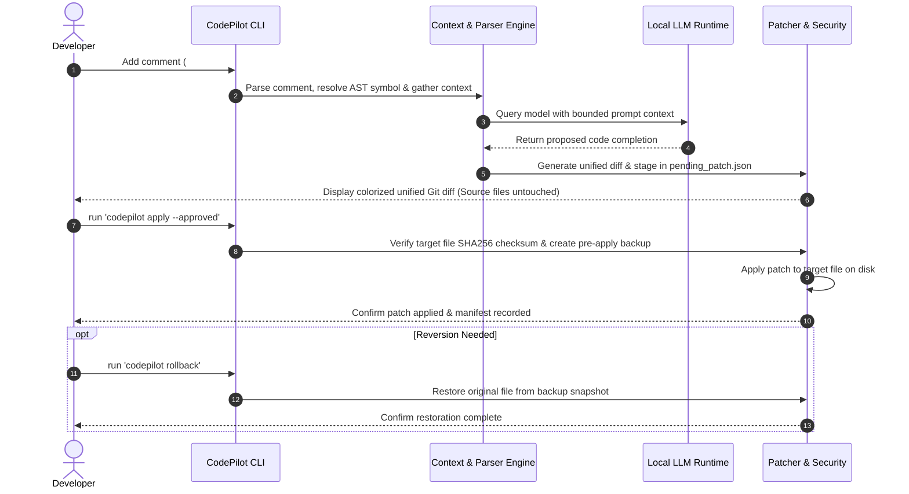

# Phase 10A.1 — Fix and Test the Standalone GGUF Backend

## Objective

Fix the existing standalone GGUF integration in CodePilot AI. Preserve the current architecture, Ollama support, mock provider, security safeguards, and all existing functionality.

**Do not rebuild the project from scratch. Make only necessary, targeted changes.**

## 1. Inspect Before Editing

Read these files and their related implementations:

- `src/codepilot/core/models/base.py`
- `src/codepilot/core/models/standalone_client.py`
- `src/codepilot/core/models/factory.py`
- `src/codepilot/config.py`
- `tests/test_models.py`
- `pyproject.toml`
- `.gitignore`

Inspect Git status and existing user changes before editing. Confirm the actual dataclass fields, constructor signatures, configuration conventions, and test setup.

## 2. Fix the Existing Defects

### A. ModelResponse constructor

In `standalone_client.py`, replace the unsupported `completion=` argument with the correct field defined by `ModelResponse`, expected to be `content=`.

Preserve all other required response metadata and follow the existing interface.

Do not modify the shared `ModelResponse` interface unnecessarily.

### B. ModelInfo constructor

Remove the unsupported `modified_at` argument from `ModelInfo` construction, unless inspection confirms that the actual interface has changed.

Ensure `list_available_models()` works correctly with valid GGUF files.

### C. Cache the loaded model

Implement lazy model-instance caching using an appropriate instance attribute, such as `self._llm`.

Requirements:

- Load the model only when generation is first requested.
- Reuse the loaded instance for subsequent requests.
- Avoid loading the same model multiple times concurrently.
- Handle initialization and inference errors clearly.
- Do not reload the model on every generation call.
- Do not automatically download models.

### D. GPU-layer configuration

Inspect the existing configuration model and add a configurable `n_gpu_layers` setting only if needed.

Requirements:

- Pass the configured value to `llama_cpp.Llama`.
- Document the meaning of `n_gpu_layers`.
- Do not assume CUDA support is installed.
- Do not automatically detect or modify GPU drivers.
- Do not automatically select an aggressive GPU configuration.
- Keep CPU execution possible when GPU offloading is unavailable.

Use safe defaults compatible with the project's existing configuration conventions.

### E. GGUF file protection

Update `.gitignore` to prevent accidental tracking of local GGUF model weights in the intended model storage location.

Preserve existing ignore rules. Do not hide unrelated project files or modify Git history.

## 3. Add Deterministic Unit Tests

Add a dedicated `TestStandaloneGGUFClient` test class or follow the existing test organization.

Use mocked `llama_cpp.Llama`, temporary directories, and controlled test fixtures.

Cover these cases:

1. Default standalone client configuration.
2. Missing `llama_cpp` dependency.
3. Missing model file.
4. Checksum verification failure.
5. Successful generation and correct `ModelResponse` formatting.
6. Model-instance reuse across multiple generation requests.
7. Correct GPU-layer parameter forwarding.
8. Successful GGUF model listing.
9. Correct factory selection for the standalone provider.
10. Model initialization and inference failures.
11. No silent fallback to mock responses.

Tests must not require actual model weights, network access, a GPU, or a running Ollama server.

Do not weaken, delete, or skip existing tests.

## 4. Preserve Existing Security Requirements

- Never apply source modifications without explicit user approval through the application's approval workflow.
- Never execute model-generated shell commands automatically.
- Never execute untrusted repository scripts automatically.
- Do not alter unrelated files or user changes.
- Do not use destructive Git commands.
- Do not delete existing GGUF files or Ollama models.
- Do not download models or install dependencies.
- Do not perform real inference, training, or GPU workloads during this phase.
- Do not silently substitute mock output when standalone inference fails.
- Preserve existing Ollama and mock provider behavior.

## 5. Test and Validation Procedure

Before running tests, inspect the test configuration and determine whether the selected tests could execute untrusted project code.

Do not install packages or modify the environment.

After confirming the test scope is safe and obtaining authorization for test execution, run:

`python -m pytest tests/test_models.py -v`

If the focused tests pass, run:

`python -m pytest tests/ -v`

Report the actual test counts, failures, and command outputs. If any test fails, investigate and fix the underlying defect without weakening assertions.

Do not claim tests passed unless they were actually executed.

## 6. Final Report

Provide:

1. Summary of the original defects.
2. Files modified and the reason for each change.
3. New tests added.
4. Exact test commands and actual results.
5. Remaining limitations or compatibility concerns.
6. Whether standalone GGUF support is ready for a real inference test.
7. Separate approval requests for installing `llama-cpp-python`, downloading a GGUF model, and running real inference.

## Scope Boundary

This phase covers **fixing and testing the existing backend only**.

Do not install `llama-cpp-python`, download GGUF weights, execute real inference, modify drivers, or launch GPU workloads. Those actions require a separate review and explicit approval.

Stop after completing this phase and providing the report.# Phase 10A.1 — Fix and Test the Standalone GGUF Backend

## Objective

Fix the existing standalone GGUF integration in CodePilot AI. Preserve the current architecture, Ollama support, mock provider, security safeguards, and all existing functionality.

**Do not rebuild the project from scratch. Make only necessary, targeted changes.**

## 1. Inspect Before Editing

Read these files and their related implementations:

- `src/codepilot/core/models/base.py`
- `src/codepilot/core/models/standalone_client.py`
- `src/codepilot/core/models/factory.py`
- `src/codepilot/config.py`
- `tests/test_models.py`
- `pyproject.toml`
- `.gitignore`

Inspect Git status and existing user changes before editing. Confirm the actual dataclass fields, constructor signatures, configuration conventions, and test setup.

## 2. Fix the Existing Defects

### A. ModelResponse constructor

In `standalone_client.py`, replace the unsupported `completion=` argument with the correct field defined by `ModelResponse`, expected to be `content=`.

Preserve all other required response metadata and follow the existing interface.

Do not modify the shared `ModelResponse` interface unnecessarily.

### B. ModelInfo constructor

Remove the unsupported `modified_at` argument from `ModelInfo` construction, unless inspection confirms that the actual interface has changed.

Ensure `list_available_models()` works correctly with valid GGUF files.

### C. Cache the loaded model

Implement lazy model-instance caching using an appropriate instance attribute, such as `self._llm`.

Requirements:

- Load the model only when generation is first requested.
- Reuse the loaded instance for subsequent requests.
- Avoid loading the same model multiple times concurrently.
- Handle initialization and inference errors clearly.
- Do not reload the model on every generation call.
- Do not automatically download models.

### D. GPU-layer configuration

Inspect the existing configuration model and add a configurable `n_gpu_layers` setting only if needed.

Requirements:

- Pass the configured value to `llama_cpp.Llama`.
- Document the meaning of `n_gpu_layers`.
- Do not assume CUDA support is installed.
- Do not automatically detect or modify GPU drivers.
- Do not automatically select an aggressive GPU configuration.
- Keep CPU execution possible when GPU offloading is unavailable.

Use safe defaults compatible with the project's existing configuration conventions.

### E. GGUF file protection

Update `.gitignore` to prevent accidental tracking of local GGUF model weights in the intended model storage location.

Preserve existing ignore rules. Do not hide unrelated project files or modify Git history.

## 3. Add Deterministic Unit Tests

Add a dedicated `TestStandaloneGGUFClient` test class or follow the existing test organization.

Use mocked `llama_cpp.Llama`, temporary directories, and controlled test fixtures.

Cover these cases:

1. Default standalone client configuration.
2. Missing `llama_cpp` dependency.
3. Missing model file.
4. Checksum verification failure.
5. Successful generation and correct `ModelResponse` formatting.
6. Model-instance reuse across multiple generation requests.
7. Correct GPU-layer parameter forwarding.
8. Successful GGUF model listing.
9. Correct factory selection for the standalone provider.
10. Model initialization and inference failures.
11. No silent fallback to mock responses.

Tests must not require actual model weights, network access, a GPU, or a running Ollama server.

Do not weaken, delete, or skip existing tests.

## 4. Preserve Existing Security Requirements

- Never apply source modifications without explicit user approval through the application's approval workflow.
- Never execute model-generated shell commands automatically.
- Never execute untrusted repository scripts automatically.
- Do not alter unrelated files or user changes.
- Do not use destructive Git commands.
- Do not delete existing GGUF files or Ollama models.
- Do not download models or install dependencies.
- Do not perform real inference, training, or GPU workloads during this phase.
- Do not silently substitute mock output when standalone inference fails.
- Preserve existing Ollama and mock provider behavior.

## 5. Test and Validation Procedure

Before running tests, inspect the test configuration and determine whether the selected tests could execute untrusted project code.

Do not install packages or modify the environment.

After confirming the test scope is safe and obtaining authorization for test execution, run:

`python -m pytest tests/test_models.py -v`

If the focused tests pass, run:

`python -m pytest tests/ -v`

Report the actual test counts, failures, and command outputs. If any test fails, investigate and fix the underlying defect without weakening assertions.

Do not claim tests passed unless they were actually executed.

## 6. Final Report

Provide:

1. Summary of the original defects.
2. Files modified and the reason for each change.
3. New tests added.
4. Exact test commands and actual results.
5. Remaining limitations or compatibility concerns.
6. Whether standalone GGUF support is ready for a real inference test.
7. Separate approval requests for installing `llama-cpp-python`, downloading a GGUF model, and running real inference.

## Scope Boundary

This phase covers **fixing and testing the existing backend only**.

Do not install `llama-cpp-python`, download GGUF weights, execute real inference, modify drivers, or launch GPU workloads. Those actions require a separate review and explicit approval.

Stop after completing this phase and providing the report.# CodePilot AI — Product Requirements Document (PRD)

> **Product Requirements, User Workflows, Functional Specifications, and Safety Standards**

**Document Version:** 2.0.0  
**Current Release:** v0.4.0  
**Status:** Approved  
**Author / Maintainer:** CodePilot AI Engineering Team  

---

## 1. Product Vision & Problem Statement

### 1.1 Product Vision
CodePilot AI is an open-source, command-line AI coding assistant engineered for developers who require local, transparent, and verified code modifications on unfamiliar Git repositories. It bridges the gap between local language models and real-world codebases by combining static repository analysis, inline instruction comments, token-budgeted context extraction, standard unified Git diffs, and mandatory developer approval gates.

### 1.2 Problem Statement
Modern software engineering requires frequent bug fixes, routine refactorings, test scaffolding, and documentation updates across diverse codebases. While cloud-hosted AI coding assistants exist, they present major operational challenges for privacy-conscious developers and offline enterprises:
1. **Intellectual Property & Compliance Risks:** Transmitting proprietary source code to third-party cloud APIs is prohibited in regulated environments (finance, defense, healthcare) and violates data privacy policies.
2. **Context Blindness:** Generic coding LLMs lack a deterministic map of an unfamiliar repository's architecture, entry points, class hierarchies, and internal module relationships, leading to hallucinated or inconsistent edits.
3. **Loss of Control & Silent Breakages:** Agents that modify files on-the-fly without transparent review frequently break existing tests, overwrite uncommitted changes, or execute unintended commands.

CodePilot AI solves these challenges by providing a 100% local, deterministic, and non-destructive CLI coding assistant that puts the developer in complete control of every code change.

---

## 2. Target Personas & Primary Use Cases

### 2.1 Target Personas
- **Solo Developers & Open Source Contributors:** Engineers working with complex, unfamiliar repositories who want local, automated assistance directly from comments in their code.
- **Enterprise & Privacy-First Engineering Teams:** Developers working under strict offline, on-premise, or air-gapped data residency policies where cloud LLM APIs are prohibited.
- **Continuous Integration / Tooling Builders:** Engineers looking for reproducible, scriptable CLI-driven code analysis, task mapping, and automated patch validation.

### 2.2 Core Use Cases

#### Use Case 1: Inline Bug Correction (`AI-FIX`)
A developer encounters an edge case in a function, places an `# AI-FIX: Handle empty list without ZeroDivisionError` comment directly above the function, inspects the task via `codepilot tasks`, reviews the proposed unified diff via `codepilot fix --preview`, and applies the verified change via `codepilot apply --approved`.

#### Use Case 2: Codebase Exploration & Architectural Mapping (`codepilot analyze`)
A developer clones an unfamiliar repository and needs to quickly understand project structure, module relationships, class hierarchies, and application entry points before writing code. `codepilot analyze --detailed` generates an instant, deterministic architectural report.

#### Use Case 3: Batch Task Auditing (`codepilot tasks --json`)
A CI script or developer utility scans the codebase for pending technical debt, documentation gaps, and test requests, outputting structured JSON to feed downstream local pipelines.

#### Use Case 4: Safe Test Verification & AI Error Correction (`codepilot test`)
After applying changes, the developer executes the project's test suite through a sandboxed runner. If tests fail, `codepilot test --approved --fix` analyzes the traceback, isolates culprit lines, and proposes a candidate patch for review.

---

## 3. Scope & Exclusions

### In Scope
- Static analysis of project architecture, language distributions, entry points, and module dependencies.
- Multi-language inline instruction comment parsing (`AI-FIX`, `AI-TASK`, `AI-REFACTOR`, `AI-TEST`, `AI-DOCS`).
- AST-level symbol resolution (associating comments with functions, methods, classes).
- Token-budgeted context extraction and prompt generation with prompt-injection defense.
- Local model inference via Ollama or standalone GGUF runtimes (`llama-cpp-python`).
- Two-stage patch review flow (preview unified diff $\rightarrow$ explicit approval $\rightarrow$ atomic apply).
- Pre-apply snapshot backups and non-destructive rollbacks.
- Safe test discovery and execution with shell-injection prevention, PID locking, and 64 KB capture limits.
- Centralized file ownership classification and path traversal prevention.

### Out of Scope
- Cloud SaaS hosting, user telemetry, or remote subscription management.
- Autonomous, unsupervised shell execution (CodePilot never executes model-generated shell scripts).
- Web-based GUI or cloud dashboards (CLI and Git terminal workflows are primary).
- In-place modification of files without explicit developer approval.

---

## 4. User Workflows

---

## 5. Functional Requirements

### 5.1 CLI & Environment Foundation
- **FR-1.1 [Implemented]:** Typer-based CLI application providing subcommands `init`, `status`, `doctor`, `scan`, `tasks`, `analyze`, `plan`, `explain`, `fix`, `diff`, `apply`, `rollback`, and `test`.
- **FR-1.2 [Implemented]:** Cascading configuration loader supporting safe defaults, `.codepilot.toml`, environment variables (`CODEPILOT_*`), and CLI overrides.
- **FR-1.3 [Implemented]:** Environment diagnostic suite (`codepilot doctor`) verifying Python 3.11+, Git CLI, write permissions, model runtimes, and security enclaves.
- **FR-1.4 [Implemented]:** Dual output formatting supporting human-readable Rich terminal cards and machine-readable JSON (`--json`).

### 5.2 Repository Discovery & Static Architecture Analysis
- **FR-2.1 [Implemented]:** Safe directory traversal honoring `.gitignore` and excluding binary files, virtual environments, and build caches.
- **FR-2.2 [Implemented]:** Python AST symbol extraction capturing classes, methods, functions, docstrings, imports, and decorators.
- **FR-2.3 [Implemented]:** Entry point detection ranking executable scripts, CLI dispatchers, and web application instances.
- **FR-2.4 [Implemented]:** Module dependency graph and class inheritance hierarchy mapping.
- **FR-2.5 [Implemented]:** Static architecture inspection command (`codepilot analyze`) with `--detailed`, `--json`, and `--context` options.

### 5.3 AI Instruction Comment Parsing & Symbol Resolution
- **FR-3.1 [Implemented]:** Multi-language comment extraction using standard library `tokenize` for Python (preventing string/docstring false positives) and regex adapters for other languages.
- **FR-3.2 [Implemented]:** Support for 5 instruction types: `AI-FIX`, `AI-TASK`, `AI-REFACTOR`, `AI-TEST`, `AI-DOCS`, plus legacy aliases.
- **FR-3.3 [Implemented]:** Support for single-line instructions and bulleted multiline continuations.
- **FR-3.4 [Implemented]:** AST symbol association linking comments to functions, classes, and qualified methods (`Class.method`).
- **FR-3.5 [Implemented]:** Instruction listing and filtering CLI commands (`codepilot scan` and `codepilot tasks --type <TYPE>`).

### 5.4 Context Assembly & Prompt Construction
- **FR-4.1 [Implemented]:** Targeted code snippet extraction surrounding target symbols with accurate line numbers.
- **FR-4.2 [Implemented]:** Automatic pairing of target source files with associated unit test files (`tests/test_<stem>.py`).
- **FR-4.3 [Implemented]:** Token-budgeted context allocation (~4 chars/token) with graceful trimming of auxiliary context under `max_context_tokens`.
- **FR-4.4 [Implemented]:** Prompt template v1.0.0 encapsulating repository content within `<untrusted_repository_context>` blocks to defend against prompt injection.
- **FR-4.5 [Implemented]:** CLI context inspection command (`codepilot explain [ID]`).

### 5.5 Modular Local Model Runtime
- **FR-5.1 [Implemented]:** Modular runtime interface (`BaseModelClient`) supporting `generate()`, `health_check()`, and `is_available()`.
- **FR-5.2 [Implemented]:** Standard library HTTP REST client for local Ollama instances (zero external dependencies).
- **FR-5.3 [Implemented]:** Standalone GGUF client using `llama-cpp-python` with cryptographic SHA256 integrity checks, fully decoupled from Ollama.
- **FR-5.4 [Implemented]:** Deterministic in-memory mock client (`MockModelClient`) for reproducible offline testing.
- **FR-5.5 [Implemented]:** Dynamic model client factory resolving provider configurations (`mock`, `ollama`, `standalone`, `none`).

### 5.6 Two-Stage Code Modification & Safe Patching
- **FR-6.1 [Implemented]:** Preview diff generation (`codepilot fix --preview`) staging unified diffs in `.codepilot/patches/pending_patch.json` without modifying disk.
- **FR-6.2 [Implemented]:** Syntax-highlighted diff inspection command (`codepilot diff`).
- **FR-6.3 [Implemented]:** Mandatory approval gate requiring `--approved` before any patch application.
- **FR-6.4 [Implemented]:** Cryptographic SHA256 staleness defense rejecting patches if target files were modified after preview.
- **FR-6.5 [Implemented]:** Pre-apply snapshot backups in `.codepilot/backups/<patch_id>/` with `manifest.json`.
- **FR-6.6 [Implemented]:** Reversible rollback command (`codepilot rollback`) restoring original files non-destructively.

### 5.7 Safe Test Execution & AI Error Correction
- **FR-7.1 [Implemented]:** Safe test discovery detecting pytest configurations, test paths, and runner binaries.
- **FR-7.2 [Implemented]:** Test preview mode (`codepilot test --preview`) showing commands without process execution.
- **FR-7.3 [Implemented]:** Concurrency file lock (`.codepilot/test.lock`) recording PID to prevent simultaneous test runs.
- **FR-7.4 [Implemented]:** Bounded execution controls enforcing timeouts and truncating output capture at 64 KB.
- **FR-7.5 [Implemented]:** Shell injection prevention strictly blocking unquoted shell operators (`;`, `&&`, `||`, `|`, `&`, `>`, `` ` ``, `$()`).
- **FR-7.6 [Implemented]:** Single-turn error correction (`codepilot test --approved --fix`) analyzing tracebacks and staging candidate fixes for developer review.

### 5.8 Security, Boundaries & File Ownership
- **FR-8.1 [Implemented]:** Authoritative project-root detection (`resolve_project_root`) via Git metadata or structural markers.
- **FR-8.2 [Implemented]:** File ownership classification into 5 tiers: `PROJECT_MANAGED`, `USER_OWNED`, `GENERATED`, `PROTECTED`, `EXTERNAL`.
- **FR-8.3 [Implemented]:** Granular operation permission checks (`check_file_permission`) enforcing approval requirements and blocking unauthorized writes.
- **FR-8.4 [Implemented]:** Canonical path validation (`validate_target_path`) blocking path traversal (`../../`) and symlink escapes.
- **FR-8.5 [Implemented]:** Protected file enclave blocking access to `.env`, credentials, private keys, `pyproject.toml`, and `.git/`.
- **FR-8.6 [Implemented]:** Automated secret masking scrubbing tokens, keys, and passwords from logs and console outputs.

### 5.9 Future Capabilities & Extensions
- **FR-9.1 [Implemented Architecture / Training Deferred]:** Coding dataset preparation and QLoRA fine-tuning configuration for consumer GPUs ($\ge 8\text{ GB}$ VRAM).
- **FR-9.2 [Planned]:** Tree-sitter AST extractors for TypeScript, Rust, Go, and Java.
- **FR-9.3 [Planned]:** Multi-turn interactive test repair loop with step-by-step user confirmation.

---

## 6. Non-Functional Requirements

### 6.1 Privacy & Data Residency
- **NFR-1.1:** 100% local execution. Source code, AST symbols, instruction comments, and logs must never be transmitted over the internet.
- **NFR-1.2:** Zero telemetry, analytics, or remote tracking.

### 6.2 Hardware Safety & Resource Budgeting
- **NFR-2.1:** Routine CLI commands (`scan`, `tasks`, `analyze`, `plan`) must run entirely on the CPU with 0 MB GPU memory allocation.
- **NFR-2.2:** Maximum resident memory for static analysis must remain $< 1\text{ GB}$ RAM.
- **NFR-2.3:** Local model execution with 1.5B quantized models must consume $\le 1.5\text{ GB}$ VRAM, preserving $\ge 6.5\text{ GB}$ headroom on standard 8 GB GPUs.
- **NFR-2.4:** CodePilot AI must never modify system drivers, power plans, or OS security configurations.

### 6.3 Performance & Response Times
- **NFR-3.1:** Static project analysis of repositories under 500 files must complete in $< 3.0\text{ seconds}$.
- **NFR-3.2:** Instruction comment scanning across 500 files must complete in $< 1.5\text{ seconds}$.
- **NFR-3.3:** CLI commands must exhibit instant startup ($< 350\text{ ms}$).

### 6.4 Reliability & Safety
- **NFR-4.1:** All 204 automated unit and integration tests must maintain a 100% pass rate.
- **NFR-4.2:** Source files must never be modified without explicit `--approved` confirmation.
- **NFR-4.3:** Destructive Git commands (`git reset --hard`, `git clean`) are strictly prohibited in all circumstances.

---

## 7. Acceptance Criteria & Verification

| Requirement Area | Acceptance Criteria | Verification Status |
|---|---|---|
| **CLI Usability** | All 13 commands support `--help`, `--json`, and return predictable exit codes (0, 1, 2) | **Verified** |
| **Comment Parsing** | Recognizes 5 instruction types, multiline continuations, and excludes string literals | **Verified** |
| **Context Assembly** | Snippets extracted with line numbers, paired with tests, strictly under token budgets | **Verified** |
| **Two-Stage Modification** | `fix --preview` modifies 0 bytes on disk; `apply --approved` requires approval flag | **Verified** |
| **Cryptographic Safety** | Rejects stale patches; creates pre-apply snapshots; non-destructive rollback succeeds | **Verified** |
| **Test Runner Safety** | Blocks shell injection; acquires concurrency lock; enforces 64 KB stream bounds | **Verified** |
| **File Ownership** | Centralized policy validates roots, blocks traversal, and protects credential files | **Verified** |
| **Model Decoupling** | Supports mock, Ollama, and standalone GGUF runtimes without hard dependencies | **Verified** |
| **Test Suite Coverage** | Complete test suite passes 100% (204/204 tests across 22 modules) | **Verified** |

---

## 8. Known Limitations

1. **AST Language Depth:** Full AST symbol resolution is currently native for Python. Non-Python languages use robust regex and token pattern matching. Tree-sitter parsers are planned for future releases.
2. **Single-Turn Correction:** `codepilot test --fix` generates a single bounded candidate patch rather than executing an autonomous recursive loop, prioritizing safety over autonomous iteration.
3. **Model Fine-Tuning Execution:** The QLoRA training dataset, validator, and configuration are complete and verified; physical fine-tuning execution remains optional and deferred per hardware safety policies.
