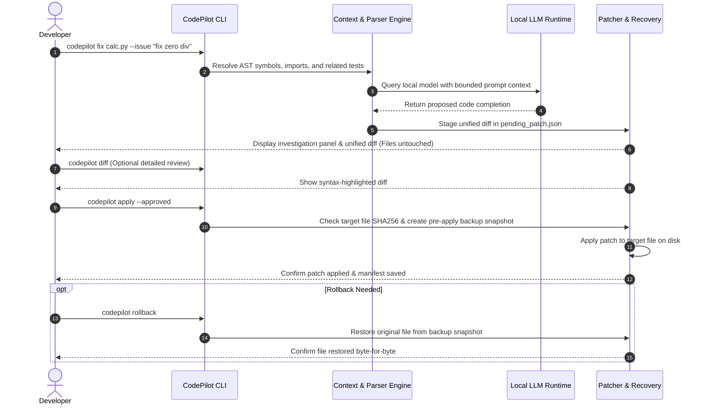

# CodePilot AI — Product Requirements Document (PRD)

> **Product Requirements, User Workflows, Functional Specifications, and Safety Standards**

**Document Version:** 2.1.0  
**Current Release:** v0.4.1  
**Status:** Approved  
**Author / Maintainer:** CodePilot AI Team  

---

## 1. Product Vision & Problem Statement

### 1.1 Product Vision
CodePilot AI is an open-source, command-line AI coding assistant built for developers who need transparent, local, and verified code edits on unfamiliar repositories. It connects local language models directly to real-world codebases by combining static repository analysis, token-budgeted context extraction, standard unified diffs, and mandatory approval before anything touches disk.

Developers can drive CodePilot entirely from the terminal (using commands like `codepilot scan`, `codepilot analyze`, `codepilot fix`, and `codepilot test`) or leave optional in-code task hints (`# AI-FIX:`, `# AI-TASK:`) when they prefer working inline.

### 1.2 Problem Statement
Software development involves a lot of routine maintenance: bug fixes, small refactorings, test scaffolding, and documentation updates across unfamiliar code. While cloud coding assistants exist, they introduce three serious problems:

1. **Privacy & Compliance Exposure:** Sending proprietary code to external APIs is unacceptable for developers working under strict NDAs, healthcare regulations, defense rules, or company security policies.
2. **Context Blindness:** Generic coding LLMs don't understand the broader repository—its entry points, class hierarchies, or dependency relationships—leading to hallucinated imports, broken signatures, or mismatched patterns.
3. **Loss of Control & Silent Breakages:** Agents that modify files behind the scenes often overwrite uncommitted local edits, break existing test suites, or execute unsafe shell commands.

CodePilot AI solves these problems by providing a 100% local, deterministic, and safe CLI coding assistant where you always see the diff, make the call, and can undo any change with one command.

---

## 2. Target Personas & Core Use Cases

### 2.1 Target Personas
- **Solo Developers & Open Source Contributors:** Engineers working with complex or unfamiliar codebases who want local, automated assistance without leaving their terminal.
- **Privacy-Conscious & Enterprise Teams:** Developers working under offline, on-premise, or air-gapped policies where cloud LLM APIs are strictly prohibited.
- **Tooling & CI Engineers:** Developers who want scriptable, reproducible CLI code analysis, health checks, and verified patch staging in local pipelines.

### 2.2 Core Use Cases

#### Use Case 1: Command-Driven Bug Fix (`codepilot fix`)
A developer notices a bug in `calc.py` and runs:
```bash
codepilot fix calc.py --issue "handle division by zero without raising ZeroDivisionError"
```
CodePilot inspects the file, extracts AST symbols and related tests, queries the local model, displays a clear explanation of the suspected cause, and generates a preview diff. The developer reviews the diff (`codepilot diff`) and applies it safely (`codepilot apply --approved`).

#### Use Case 2: Codebase Exploration & Architecture Mapping (`codepilot analyze`)
A developer clones an unfamiliar project and wants a quick overview of its structure, dependencies, class hierarchies, and entry points before diving in:
```bash
codepilot analyze --detailed
```
CodePilot generates an instant, deterministic architectural report on CPU with zero GPU memory usage.

#### Use Case 3: Health & Project Scanning (`codepilot scan`)
A developer checks a repository's health:
```bash
codepilot scan
```
CodePilot reports file extension breakdowns, detected configuration files, test suites, skipped files (with reasons), and static syntax defects—with or without AI instruction comments.

#### Use Case 4: Optional In-Code Task Hints (`# AI-FIX:`)
When developers prefer annotating code while reading it, they can add an inline comment:
```python
# AI-FIX: Handle empty list gracefully without ZeroDivisionError
def calculate_average(items):
    ...
```
`codepilot tasks` finds and tracks these comments, while `codepilot fix -t <task-id>` generates targeted fixes.

#### Use Case 5: Safe Test Verification & AI Error Repair (`codepilot test`)
After applying changes, the developer runs tests through the sandboxed runner:
```bash
codepilot test --approved
```
If tests fail, running `codepilot test --approved --fix` analyzes the failure traceback, isolates the culprit line, and stages a candidate repair patch for review.

---

## 3. Scope & Boundaries

### In Scope
- Static analysis of project structure, languages, entry points, and module relationships.
- Command-driven fixes targeting specific files and issues directly from the terminal.
- Optional multi-language comment parsing (`AI-FIX`, `AI-TASK`, `AI-REFACTOR`, `AI-TEST`, `AI-DOCS`).
- AST symbol resolution (associating fixes with functions, methods, and classes).
- Token-budgeted prompt context assembly with untrusted repository boundaries.
- Local model inference via Ollama or standalone GGUF runtimes (`llama-cpp-python`).
- Two-stage patch review workflow: preview unified diff $\rightarrow$ explicit developer approval $\rightarrow$ atomic apply.
- Automatic pre-apply backup snapshots and non-destructive rollbacks.
- Safe test discovery and execution with shell-injection prevention, PID locking, and 64 KB output capture.
- Canonical path validation, file ownership tiers, and sensitive file protection.

### Out of Scope
- Cloud SaaS hosting, accounts, or telemetry tracking.
- Unsupervised, autonomous shell command execution.
- Web dashboards or GUI clients (CodePilot is strictly a CLI and Git terminal tool).
- Modifying files on disk without explicit user approval.

---

## 4. User Workflows



---

## 5. Functional Requirements

### 5.1 CLI & Environment
- **FR-1.1 [Implemented]:** Typer-based CLI providing commands: `init`, `status`, `doctor`, `scan`, `tasks`, `analyze`, `plan`, `explain`, `fix`, `diff`, `apply`, `rollback`, `test`, and `evaluate`.
- **FR-1.2 [Implemented]:** Cascading configuration loading from defaults, `.codepilot.toml`, environment variables (`CODEPILOT_*`), and CLI flags.
- **FR-1.3 [Implemented]:** Diagnostic check suite (`codepilot doctor`) verifying Python 3.11+, Git CLI, write permissions, model runtimes, and security enclaves.
- **FR-1.4 [Implemented]:** Dual output modes: formatted Rich terminal tables by default, and clean JSON (`--json`) for scripting.

### 5.2 Repository Discovery & Static Analysis
- **FR-2.1 [Implemented]:** Safe directory traversal honoring `.gitignore` while ignoring binaries, virtual environments, and build caches.
- **FR-2.2 [Implemented]:** Python AST symbol extraction capturing classes, methods, functions, docstrings, imports, and decorators.
- **FR-2.3 [Implemented]:** Entry point detection ranking executable scripts, CLI dispatchers, and web app entry points.
- **FR-2.4 [Implemented]:** Module dependency graph and class inheritance mapping.
- **FR-2.5 [Implemented]:** Static architecture inspection via `codepilot analyze` with `--detailed`, `--json`, and `--context` options.

### 5.3 Comment Parsing & Symbol Resolution (Optional Hints)
- **FR-3.1 [Implemented]:** Multi-language comment extraction using standard library `tokenize` for Python (preventing string/docstring false positives) and regex adapters for other languages.
- **FR-3.2 [Implemented]:** Support for 5 instruction types: `AI-FIX`, `AI-TASK`, `AI-REFACTOR`, `AI-TEST`, and `AI-DOCS`, plus legacy aliases.
- **FR-3.3 [Implemented]:** Support for single-line comments and bulleted multiline continuations.
- **FR-3.4 [Implemented]:** AST symbol association linking comments to functions, classes, and methods (`Class.method`).
- **FR-3.5 [Implemented]:** Task listing and filtering via `codepilot tasks --type <TYPE>`.

### 5.4 Context Assembly & Prompt Construction
- **FR-4.1 [Implemented]:** Line-numbered code snippet extraction surrounding target symbols.
- **FR-4.2 [Implemented]:** Automatic pairing of target source files with associated unit test files (`tests/test_<stem>.py`).
- **FR-4.3 [Implemented]:** Token-budgeted context allocation (~4 chars/token) with graceful trimming of auxiliary context under `max_context_tokens`.
- **FR-4.4 [Implemented]:** Prompt template v1.0.0 encapsulating code inside `<untrusted_repository_context>` blocks to defend against prompt injection.
- **FR-4.5 [Implemented]:** Context inspection command via `codepilot explain [ID]`.

### 5.5 Modular Local Model Runtime
- **FR-5.1 [Implemented]:** Modular runtime interface (`BaseModelClient`) supporting `generate()`, `health_check()`, and `is_available()`.
- **FR-5.2 [Implemented]:** Lightweight HTTP REST client for local Ollama instances using Python standard library `urllib.request`.
- **FR-5.3 [Implemented]:** Standalone GGUF client using `llama-cpp-python` with cryptographic SHA256 integrity checks, fully decoupled from Ollama.
- **FR-5.4 [Implemented]:** Deterministic in-memory mock client (`MockModelClient`) for fast, offline testing.
- **FR-5.5 [Implemented]:** Dynamic client factory resolving provider configurations (`mock`, `ollama`, `standalone`, `none`).

### 5.6 Two-Stage Patching & Reversible Recovery
- **FR-6.1 [Implemented]:** Preview diff generation (`codepilot fix --preview`) staging unified diffs in `.codepilot/patches/pending_patch.json` without modifying disk.
- **FR-6.2 [Implemented]:** Syntax-highlighted diff inspection via `codepilot diff`.
- **FR-6.3 [Implemented]:** Mandatory approval gate requiring `--approved` before any patch is applied.
- **FR-6.4 [Implemented]:** SHA256 staleness defense rejecting patches if target files were modified after the preview was generated.
- **FR-6.5 [Implemented]:** Pre-apply snapshot backups saved to `.codepilot/backups/<patch_id>/` with `manifest.json`.
- **FR-6.6 [Implemented]:** Reversible rollback command (`codepilot rollback`) restoring original files non-destructively.

### 5.7 Safe Test Execution & AI Failure Repair
- **FR-7.1 [Implemented]:** Test discovery detecting pytest, npm, cargo, and go test runners.
- **FR-7.2 [Implemented]:** Test preview mode (`codepilot test --preview`) showing the command without running subprocesses.
- **FR-7.3 [Implemented]:** Concurrency file lock (`.codepilot/test.lock`) recording PID to prevent simultaneous test runs.
- **FR-7.4 [Implemented]:** Bounded execution controls enforcing timeouts and truncating output capture at 64 KB.
- **FR-7.5 [Implemented]:** Shell injection prevention strictly blocking unquoted shell operators (`;`, `&&`, `||`, `|`, `&`, `>`, `` ` ``, `$()`).
- **FR-7.6 [Implemented]:** Single-turn error repair (`codepilot test --approved --fix`) analyzing tracebacks and staging candidate fixes for review.

### 5.8 Security, Boundaries & File Ownership
- **FR-8.1 [Implemented]:** Authoritative project-root detection (`resolve_project_root`) via Git metadata or structural markers.
- **FR-8.2 [Implemented]:** File ownership classification into 5 tiers: `PROJECT_MANAGED`, `USER_OWNED`, `GENERATED`, `PROTECTED`, and `EXTERNAL`.
- **FR-8.3 [Implemented]:** Granular operation permissions enforcing approval requirements and blocking unauthorized writes.
- **FR-8.4 [Implemented]:** Canonical path validation (`validate_target_path`) blocking path traversal (`../../`) and symlink escapes.
- **FR-8.5 [Implemented]:** Protected file enclave blocking access to `.env`, credentials, private keys, `pyproject.toml`, and `.git/`.
- **FR-8.6 [Implemented]:** Secret redaction masking API keys, tokens, and passwords from logs and console outputs while preserving line numbers.

### 5.9 Future Capabilities
- **FR-9.1 [Planned]:** Tree-sitter AST extractors for TypeScript, Rust, Go, and Java.
- **FR-9.2 [Planned]:** Multi-turn interactive test repair loop with step-by-step confirmation.
- **FR-9.3 [Planned]:** Dedicated QLoRA fine-tuning execution pipeline.

---

## 6. Non-Functional Requirements

### 6.1 Privacy & Data Residency
- **NFR-1.1:** 100% local execution. Source code, AST symbols, comments, and logs never leave the local machine.
- **NFR-1.2:** Zero telemetry, analytics, or remote tracking.

### 6.2 Hardware Efficiency & Resource Safety
- **NFR-2.1:** Routine CLI commands (`scan`, `tasks`, `analyze`, `plan`) run entirely on the CPU with 0 MB GPU allocation.
- **NFR-2.2:** Memory usage for static analysis remains under 1 GB RAM.
- **NFR-2.3:** Local model execution with 1.5B quantized models consumes $\le 1.5\text{ GB}$ VRAM, preserving plenty of headroom on standard GPUs.
- **NFR-2.4:** CodePilot AI never alters system drivers, power plans, or OS security configurations.

### 6.3 Performance & Responsiveness
- **NFR-3.1:** Static project analysis of repositories under 500 files completes in $< 3.0\text{ seconds}$.
- **NFR-3.2:** Comment scanning across 500 files completes in $< 1.5\text{ seconds}$.
- **NFR-3.3:** CLI commands start up almost instantly ($< 350\text{ ms}$).

### 6.4 Reliability & Safety
- **NFR-4.1:** All 610 automated tests maintain a 100% pass rate.
- **NFR-4.2:** Source files are never modified without explicit `--approved` confirmation.
- **NFR-4.3:** Destructive Git commands (`git reset --hard`, `git clean`) are strictly forbidden.

---

## 7. Acceptance Criteria & Verification

| Requirement Area | Acceptance Criteria | Verification Status |
|---|---|---|
| **CLI Usability** | All 14 commands support `--help`, `--json`, and return predictable exit codes (0, 1, 2) | **Verified** |
| **Command-Driven Flow** | Direct file and issue targeting without requiring comments | **Verified** |
| **Comment Parsing** | Recognizes 5 instruction types, multiline continuations, and excludes string literals | **Verified** |
| **Context Assembly** | Snippets extracted with line numbers, paired with tests, strictly under token budgets | **Verified** |
| **Two-Stage Modification** | `fix --preview` modifies 0 bytes on disk; `apply --approved` requires approval flag | **Verified** |
| **Safety & Recovery** | Rejects stale patches; creates pre-apply snapshots; non-destructive rollback restores original files | **Verified** |
| **Test Runner Safety** | Blocks shell injection; acquires concurrency lock; enforces 64 KB stream bounds | **Verified** |
| **File Ownership** | Centralized policy validates roots, blocks traversal, and protects credential files | **Verified** |
| **Model Decoupling** | Supports mock, Ollama, and standalone GGUF runtimes without hard external dependencies | **Verified** |
| **Test Suite Coverage** | Complete test suite passes 100% (610/610 tests across 29 modules) | **Verified** |

---

## 8. Known Limitations

1. **AST Language Depth:** Full AST symbol resolution is native for Python. Non-Python languages use robust regex and token pattern matching; Tree-sitter parsers are planned for future releases.
2. **Single-Turn Correction:** `codepilot test --fix` generates a single bounded candidate patch rather than running an autonomous loop, prioritizing safety over automated iteration.
3. **Model Fine-Tuning Execution:** The QLoRA training dataset, validator, and configuration are verified; physical fine-tuning execution remains optional when dedicated training compute is available.
